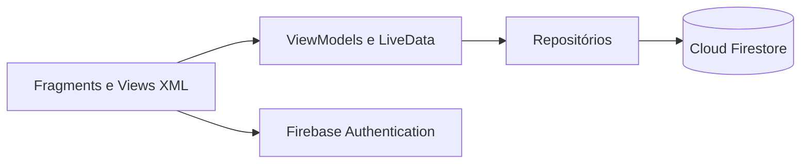

# NutriProntuario

**Pacientes, consultas, medidas e planos alimentares organizados em um aplicativo Android.**

Aplicação nativa em Kotlin voltada ao acompanhamento nutricional. Reúne autenticação, cadastro de pacientes e um perfil com áreas para resumo, consultas, medidas antropométricas e planos alimentares. Os dados são acessados pelo Firebase, com repositórios separados da interface.

[Recursos](#recursos) · [Arquitetura](#arquitetura) · [Configuração](#configuração-e-execução) · [Código](#organização-do-código)

## Recursos

| Área | Funcionalidades |
| --- | --- |
| Acesso | Cadastro e login por Firebase Authentication. |
| Pacientes | Cadastro, listagem, pesquisa por nome, edição e exclusão. |
| Atualização | Listener do Firestore para acompanhar a lista de pacientes do proprietário. |
| Prontuário | Abas de resumo, consultas, medidas e planos. |
| Acompanhamento | Organização do histórico de atendimentos e registros nutricionais. |

A lista é filtrada por `ownerUid` e ordenada por nome no repositório de pacientes. Esse filtro organiza a consulta, mas a proteção dos dados depende também das regras efetivamente publicadas no Firestore.

## Arquitetura



| Camada | Tecnologias |
| --- | --- |
| Android | Kotlin, Activity única e Fragments. |
| Estado e navegação | ViewModel, LiveData, Navigation Component e SafeArgs. |
| Interface | ViewBinding, Material Components, RecyclerView, ConstraintLayout e ViewPager2. |
| Dados | Firebase Authentication, Cloud Firestore e Firebase BOM. |
| Build | Gradle Kotlin DSL. |

O módulo Android declara **minSdk 24**, **compileSdk 36** e **targetSdk 36**, com alvo de compilação Java/Kotlin 11. O JDK que executa o Gradle deve ser compatível com a versão do plugin Android utilizada; o alvo de bytecode não define sozinho esse requisito.

## Configuração e execução

Use Android Studio, SDK Android correspondente ao projeto e um emulador ou dispositivo compatível. Prepare um projeto Firebase exclusivo para desenvolvimento, sem dados reais de pacientes.

```bash
git clone https://github.com/dlr-1337/NutriProntuario.git
cd NutriProntuario
```

No projeto Firebase, registre um aplicativo Android com o identificador **`com.example.nutriprontuario`**. Coloque sua configuração em `app/google-services.json`, habilite autenticação por e-mail/senha e crie o Cloud Firestore com regras restritivas para os proprietários dos registros.

Abra a raiz no Android Studio, sincronize o Gradle e execute o módulo `app`. Para compilar pela linha de comando após configurar SDK e Firebase:

```bash
# Linux / macOS
bash gradlew assembleDebug
```

```powershell
# Windows
.\gradlew.bat assembleDebug
```

Não utilize regras abertas de teste com informações reais. Contas de serviço, credenciais administrativas e arquivos privados de operação não devem ser versionados.

## Organização do código

Base: [`app/src/main/java/com/example/nutriprontuario`](app/src/main/java/com/example/nutriprontuario/).

| Diretório | Responsabilidade |
| --- | --- |
| `data/model` | Modelos de pacientes, consultas e planos. |
| `data/firebase` | Operações e listeners do Firestore. |
| `ui/auth` | Login e cadastro. |
| `ui/patients` | Lista, formulário e perfil do paciente. |
| `ui/consultations` | Consultas. |
| `ui/plans` | Planos alimentares. |
| `ui/settings` | Configurações da interface. |

Comece por [`PatientRepository.kt`](app/src/main/java/com/example/nutriprontuario/data/firebase/PatientRepository.kt) para acompanhar consulta, gravação e exclusão dos registros. As dependências e configurações do aplicativo estão em [`app/build.gradle.kts`](app/build.gradle.kts).

## Cuidados para uso e demonstração

O código distingue exclusão apenas do documento do paciente e exclusão sequencial das subcoleções. Essa sequência não deve ser tratada como uma transação atômica de todo o prontuário; valide falhas e recuperação antes de utilizar exclusões em um ambiente real.

Sincronização e cache do provedor não substituem uma política de backup, controle de acesso e retenção. Para apresentações e capturas de tela, utilize pacientes fictícios. O repositório demonstra uma aplicação de gestão e não representa certificação de segurança, conformidade ou adequação clínica.
